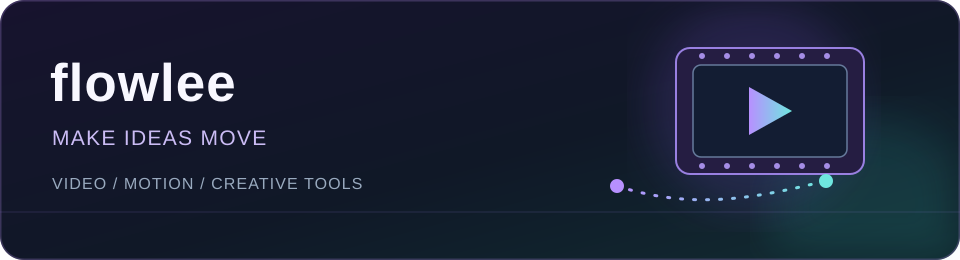

  
    
  <a href="https://x.com/flowlab09">X / @flowlab09</a>
  &nbsp;·&nbsp;
  <a href="https://github.com/flowlab09/Moa">Explore Moa</a>

 

### Hi, I'm flowlee 👋

I work with video, motion, and 3D—and I build small tools around the creative process. I'm learning to code by making things I actually want to use.

### What I'm exploring

| 🎬 Video & motion | 🧊 3D & animation | ✨ Creative tools |
| :--- | :--- | :--- |
| Editing, visual storytelling, and motion graphics | Experiments and animation in Blender | Tools that make creative work easier |

### Featured project

**[Moa — a personal canvas for Windows](https://github.com/flowlab09/Moa)**

A freeform space for arranging text, drawings, images, and videos. Built for collecting ideas and shaping them visually.

[View the project →](https://github.com/flowlab09/Moa)

 

### Currently learning

`Git & GitHub` · `Python` · `Java` · `After Effects`

One project at a time. Always learning, always making.
